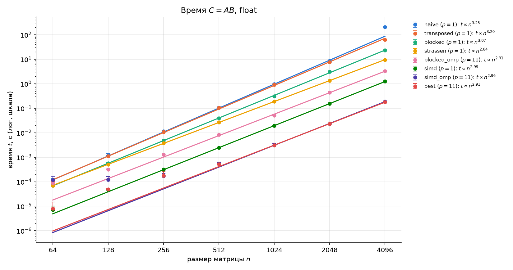
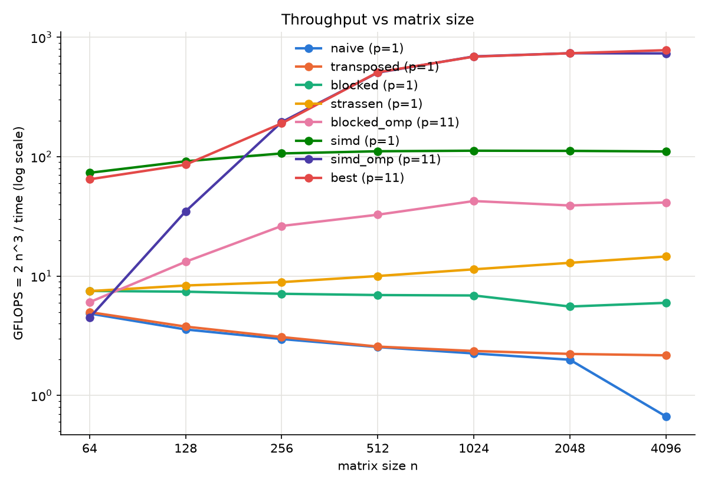
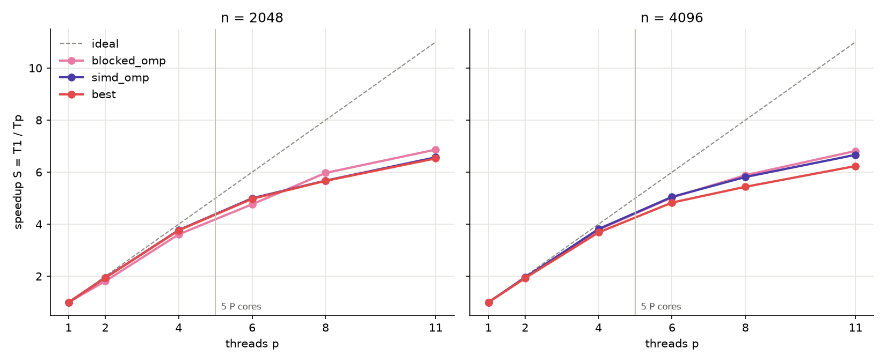
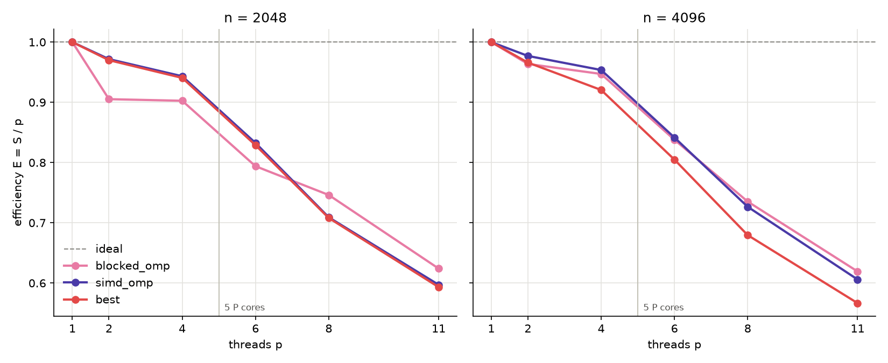

# Лабораторная работа 1: умножение матриц

$C = AB$ для квадратных матриц `float` (row-major) в восьми версиях по
пунктам задания, $n = 64, 128, \dots, 4096$.

## Версии

| версия | пункт | идея |
|---|---|---|
| `naive` | 1 | тройной цикл `i, j, k`; столбец $B$ читается с шагом $n$ |
| `transposed` | 2 | $B$ транспонируется (внутри замера), обе матрицы читаются по строкам |
| `blocked` | 3 | блоки $64 \times 64$, порядок `ii, kk, jj, i, k, j` |
| `strassen` | 4 | рекурсия Штрассена до $n \le 64$, дальше `blocked` |
| `blocked_omp` | 5 | `blocked` + OpenMP по полосам из 64 строк $C$ |
| `simd` | 6 | упакованный GEMM с регистровым блоком $8 \times 12$ на NEON, 1 поток |
| `simd_omp` | 5 + 6 | `simd` + OpenMP по блокам $C$ размера $64 \times 192$ |
| `best` | все | `simd_omp`; до $n = 256$ в 1 поток; при $n \ge 4096$ сверху один уровень Штрассена |

- **Блоки (п. 3).** Три блока $64 \times 64$ занимают
  $3 \cdot 64^2 \cdot 4\ \text{Б} = 48$ КиБ и помещаются в L1d самого
  маленького ядра (64 КиБ). Перебор 16-256 подтвердил 64 до $n = 1024$; при
  2048 блок 256 быстрее на 15%, потому что скалярное ядро упирается в
  арифметику, а не в память. Выигрыш над `transposed` (в 2.5-3 раза) даёт в
  основном порядок `k, j`: независимые обновления $C$ вместо одной цепочки FMA.
- **Штрассен (п. 4).** 7 произведений половинного размера вместо 8, результат
  накапливается прямо в четверти $C$, нужно три временных буфера на уровень.
  Размеры, которые не делятся до порога, дополняются нулями
  ($513 \to 520 = 65 \cdot 2^3$). Порог 32 быстрее на 4%, но погрешность при
  4096 равна $1.1 \cdot 10^{-4}$ против $3.9 \cdot 10^{-5}$ у 64, поэтому
  выбран 64.
- **SIMD (п. 6).** M3 Pro - arm64, поэтому SSE/AVX из методички не подходят,
  используется NEON (`<arm_neon.h>`, 4 float в регистре). Блок $C$ размера
  $8 \times 12$ держится в 24 из 32 регистров, на каждый $k$ - 24
  `vfmaq_laneq_f32` (схема GotoBLAS). $A$ и $B$ упаковываются в панели;
  $K_C, M_C, N_C = 512, 64, 192$ подобраны перебором. Пик ядра
  $4 \cdot 4 \cdot 2 \cdot 4.05\ \text{ГГц} \approx 130$ GFLOPS, `simd` даёт
  112 (86%).
- **OpenMP (п. 5).** Каждый кусок $C$ пишет один поток, общих счётчиков нет;
  false sharing возможен только на границах кусков, а при $n = 2^k$ их
  нет. `schedule(dynamic, 1)`: быстрые ядра берут больше блоков.
- **best.** Параллельный вызов стоит около 100 мкс, поэтому до 256 - один
  поток. Штрассен при 4096 даёт +6%, при 2048 и меньше невыгоден.

## Методика

- Apple M3 Pro: 5 производительных ядер (L1d 128 КБ, общий L2 16 МБ) и 6
  энергоэффективных (L1d 64 КБ, L2 4 МБ), 18 ГБ, от сети, без фоновой
  нагрузки.
- Homebrew clang 20.1.8, libomp, `-O3 -march=native`. Пункты 1-4 собраны
  без автовекторизации, чтобы эффект SIMD был виден отдельно, и с
  `-falign-loops=64` (без него одна копия цикла `blocked` была вдвое
  медленнее из-за пересечения 64-байтной границы).
- Входные данные - случайные числа из $[0, 1)$; временная память выделяется
  внутри вызова и входит во время. Время - `omp_get_wtime()`, минимум по повторам
  (1-3 запуска по 1-10 повторов).
- Последовательные версии - `OMP_NUM_THREADS=1`, параллельные - 11 потоков;
  масштабирование - $p = 1, 2, 4, 6, 8, 11$ при $n = 2048$ и $4096$.
- Корректность: `matmul_test` сравнивает каждую версию с `naive`
  (относительная погрешность $10^{-3}$) и проверяет единичные входы точно,
  $n$ от 1 до 513; ветки больших $n$ сверены с `simd_omp` при 4096.
- Графики (`plots.ipynb`): погрешность - статистическая по повторным измерениям.
  Зависимость времени от размера аппроксимирована прямыми в
  лог-лог масштабе (степенной закон, см. ниже), ускорение и эффективность -
  сглаживающим сплайном.

Производительность, ускорение и эффективность:

$$\mathrm{GFLOPS} = \frac{2n^3}{t}, \qquad S = \frac{T(1)}{T(p)}, \qquad E = \frac{S}{p}$$

```sh
cmake -S . -B build && cmake --build build -j && ctest --test-dir build
OMP_NUM_THREADS=1 ./build/lab_1/bench -v simd -r 5 1024 2048
OMP_NUM_THREADS=11 ./build/lab_1/bench -v best -r 3 4096
.venv/bin/jupyter nbconvert --to notebook --execute --inplace lab_1/plots.ipynb
```

## Результаты

Время ($p$ - число потоков):

| версия | $p$ | 64 | 128 | 256 | 512 | 1024 | 2048 | 4096 |
|---|---|---:|---:|---:|---:|---:|---:|---:|
| naive | 1 | 108 мкс | 1.18 мс | 11.31 мс | 105.61 мс | 955.51 мс | 8.63 с | 206 с |
| transposed | 1 | 105 мкс | 1.11 мс | 10.88 мс | 104.64 мс | 911.48 мс | 7.71 с | 63.40 с |
| blocked | 1 | 70 мкс | 567 мкс | 4.72 мс | 38.72 мс | 312.26 мс | 3.09 с | 23.03 с |
| strassen | 1 | 70 мкс | 503 мкс | 3.77 мс | 26.81 мс | 188.51 мс | 1.33 с | 9.42 с |
| blocked_omp | 11 | 87 мкс | 318 мкс | 1.28 мс | 8.22 мс | 50.50 мс | 440.16 мс | 3.32 с |
| simd | 1 | 7 мкс | 46 мкс | 315 мкс | 2.42 мс | 19.12 мс | 153.51 мс | 1.24 с |
| simd_omp | 11 | 117 мкс | 120 мкс | 172 мкс | 530 мкс | 3.10 мс | 23.34 мс | 187.31 мс |
| best | 11 | 8 мкс | 49 мкс | 176 мкс | 526 мкс | 3.12 мс | 23.33 мс | 175.98 мс |

Степенной закон $t = c\,n^k$: показатель $k$ - наклон прямой МНК в
координатах $(\log n, \log t)$ по точкам участка, где закон выполняется.
На графиках прямые продлены на весь диапазон $n$; точки вне участка -
выбросы (`naive` при 4096 - выход из кэша, параллельные версии при малых
$n$ - накладные расходы потоков) и в МНК не учитываются.

| версия | участок $n$ | $k$ |
|---|---|---:|
| naive | 64-2048 | 3.25 |
| transposed | 64-4096 | 3.20 |
| blocked | 64-4096 | 3.07 |
| strassen | 64-4096 | 2.84 |
| blocked_omp | 512-4096 | 2.91 |
| simd | 256-4096 | 2.99 |
| simd_omp | 1024-4096 | 2.96 |
| best | 1024-4096 | 2.91 |



GFLOPS (для Штрассена - эффективные, по $2n^3$):

| версия | $p$ | 64 | 128 | 256 | 512 | 1024 | 2048 | 4096 |
|---|---|---:|---:|---:|---:|---:|---:|---:|
| naive | 1 | 4.9 | 3.6 | 3.0 | 2.5 | 2.2 | 2.0 | 0.7 |
| transposed | 1 | 5.0 | 3.8 | 3.1 | 2.6 | 2.4 | 2.2 | 2.2 |
| blocked | 1 | 7.5 | 7.4 | 7.1 | 6.9 | 6.9 | 5.6 | 6.0 |
| strassen | 1 | 7.5 | 8.3 | 8.9 | 10.0 | 11.4 | 12.9 | 14.6 |
| blocked_omp | 11 | 6.0 | 13.2 | 26.3 | 32.7 | 42.5 | 39.0 | 41.3 |
| simd | 1 | 73.3 | 91.6 | 106.5 | 111.1 | 112.3 | 111.9 | 110.7 |
| simd_omp | 11 | 4.5 | 34.9 | 195.2 | 506.5 | 692.5 | 736.2 | 733.7 |
| best | 11 | 64.7 | 85.8 | 190.4 | 510.4 | 689.2 | 736.3 | 781.0 |



Ускорение и эффективность, $S / E$:

| версия | $n$ | $T(1)$ | $T(11)$ | $p=2$ | $p=4$ | $p=6$ | $p=8$ | $p=11$ |
|---|---|---:|---:|---:|---:|---:|---:|---:|
| blocked_omp | 2048 | 3.09 с | 450.16 мс | 1.81 / 0.91 | 3.61 / 0.90 | 4.76 / 0.79 | 5.97 / 0.75 | 6.87 / 0.62 |
| blocked_omp | 4096 | 23.04 с | 3.38 с | 1.93 / 0.96 | 3.79 / 0.95 | 5.03 / 0.84 | 5.88 / 0.74 | 6.81 / 0.62 |
| simd_omp | 2048 | 152.66 мс | 23.24 мс | 1.94 / 0.97 | 3.77 / 0.94 | 5.00 / 0.83 | 5.67 / 0.71 | 6.57 / 0.60 |
| simd_omp | 4096 | 1.24 с | 186.10 мс | 1.95 / 0.98 | 3.81 / 0.95 | 5.05 / 0.84 | 5.81 / 0.73 | 6.67 / 0.61 |
| best | 2048 | 152.23 мс | 23.32 мс | 1.94 / 0.97 | 3.76 / 0.94 | 4.97 / 0.83 | 5.66 / 0.71 | 6.53 / 0.59 |
| best | 4096 | 1.09 с | 175.17 мс | 1.93 / 0.97 | 3.68 / 0.92 | 4.83 / 0.80 | 5.44 / 0.68 | 6.23 / 0.57 |





## Выводы

- Показатель $k$ подтверждает асимптотику: около 3 для классических версий
  и 2.84 для Штрассена (теория $\log_2 7 \approx 2.81$). У `naive` и
  `transposed` $k > 3$: с ростом $n$ данные хуже держатся в кэше, и каждая
  операция дорожает. У блочных и SIMD-версий $k \approx 3$.
- `naive` и `transposed` до 2048 одинаково медленны (около 2 GFLOPS):
  обе упираются в цепочку зависимых FMA. При 4096 столбцы $B$ уже не держатся
  в кэше, и `naive` падает до 0.7 GFLOPS (точка выше своей прямой), а
  `transposed` в 3.2 раза быстрее.
- `blocked` держит 5.6-7.5 GFLOPS на всех размерах; `strassen` при 4096 в
  2.4 раза быстрее своего базового ядра.
- `simd` в 16-20 раз быстрее `blocked` и держит 110 GFLOPS начиная с
  $n = 512$. Потоки окупаются с $n = 256$.
- `best`: 736 GFLOPS при 2048 (23.3 мс) и 781 при 4096 (176 мс), в 1170 раз
  быстрее `naive`.
- Масштабирование почти линейное до 4 потоков ($E = 0.90 \dots 0.98$) и
  замедляется после 5: дальше идут энергоэффективные ядра, примерно втрое
  более медленные. С учётом этого для `simd_omp`
  $E = \frac{6.7}{5 + 6/3} \approx 0.95$: предел задаёт неоднородное железо,
  а не алгоритм. `best` при 4096 масштабируется хуже (6.2 против 6.7), потому
  что сложения Штрассена упираются в пропускную способность памяти.
