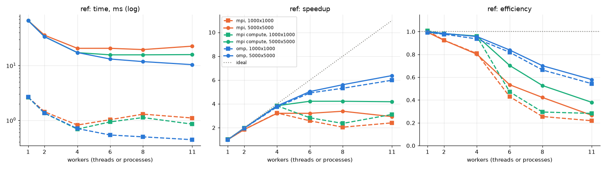
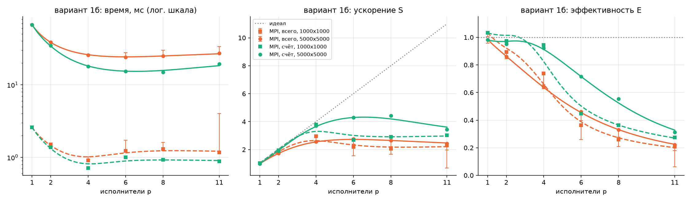
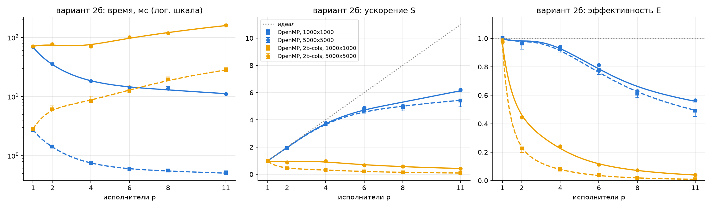
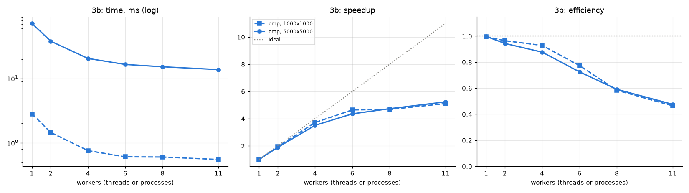

# Lab 2: effective loop parallelization

The assignment takes the reference loop and the individual variants **1b**
(MPI), **2b** (OpenMP) and **3b** (OpenMP) from the manual, analyzes their
data dependences, writes a sequential and a parallel version of each, checks
that both produce identical result files, and measures time, speedup and
efficiency against the number of workers. As the manual requires, the
reference loop is parallelized with both technologies, OpenMP (shared memory)
and MPI (distributed memory).

All measurements are on an Apple M3 Pro (5 performance and 6 efficiency
cores, as reported by `sysctl hw.perflevel0.physicalcpu
hw.perflevel1.physicalcpu`), Open MPI 5.0.7, Homebrew libomp, Apple clang
with `-O3 -march=native`.

## How to build, test and run

```sh
cmake -S . -B build && cmake --build build -j
ctest --test-dir build -R lab_2 --output-on-failure
./build/lab_2/lab2_seq -v 1b -n 5000 -m 5000 -o seq.txt
mpirun -np 4 ./build/lab_2/lab2_mpi -v 1b -n 5000 -m 5000 -o par.txt -c
cmp seq.txt par.txt
./build/lab_2/lab2_omp -v 2b -t 6 -c
lab_2/scripts/bench.sh            # writes lab_2/results/<variant>.csv
.venv/bin/jupyter nbconvert --to notebook --execute --inplace lab_2/plots.ipynb
```

Options of all three programs: `-v variant`, `-n ISIZE`, `-m JSIZE` (both
default 5000), `-r reps`, `-t threads` (OpenMP only), `-o file` (write the
result in the manual's `"%f "` format), `-c` (compare with the sequential
version bit for bit), `-H` (print the CSV header). The CSV columns are
`variant,impl,isize,jsize,workers,reps,min_s,mean_s,comp_s`.

## Common part

**Problem size.** The manual asks for `ISIZE = JSIZE = 5000` for the full
grade. The original code declares `double a[ISIZE][JSIZE]` on the stack,
which at 5000 x 5000 is 200 MB and overflows the stack (8 MB for the main
thread on macOS). The grids are therefore allocated on the heap and the sizes
are command-line parameters. Every variant is measured at 1000 x 1000 (the
original size) and 5000 x 5000.

**What is timed.** Only the loop nest, as the manual says: the initialization
loop `a[i][j] = 10*i + j` and the file output are outside the timed region.
The grid is re-initialized before every repetition and the reported time is
the minimum over 30 (1000 x 1000) or 7 (5000 x 5000) repetitions. OpenMP uses
`omp_get_wtime`, MPI uses `MPI_Wtime` (maximum over ranks), the sequential
program uses `clock_gettime(CLOCK_MONOTONIC)`. For MPI the timed region
includes collecting the result on rank 0, because without it the computation
is not finished; the loop alone is reported separately as `comp_s`.

**Speedup and efficiency.** `S = T_seq / T_p`, `E = S / p`, where `T_seq` is
the separate sequential program at the same size (the best sequential
version, not the parallel one run on one worker).

**Correctness.** All implementations share the loop bodies
(`include/loops.h`), so each element is computed by the same floating-point
operations from the same input, and the results must match bit for bit,
not just within a tolerance. ctest checks this in two ways for every
parallel version: in-process (`-c`, several thread and process counts and
two sizes, one of them smaller than the number of workers) and the way the
manual prescribes, by writing `result.txt`-style files from the sequential
and the parallel program and comparing them (`tests/compare_files.cmake`).
The same file comparison was also run once at 5000 x 5000 with 11 workers
for every implementation: all files (about 237 MB each) are identical.

**Structure.**
- `include/loops.h`, `src/grid.c`, `src/options.c`: grid allocation,
  initialization, output, bitwise comparison, command-line options.
- `src/seq.c`, `src/run_seq.c` (`lab2_seq`): sequential reference programs.
- `src/run_omp.c` (`lab2_omp`): OpenMP versions of `ref`, `2b`, `2b-cols`,
  `3b`.
- `src/run_mpi.c` (`lab2_mpi`): MPI versions of `ref` and `1b`.
- `scripts/bench.sh`, `results/*.csv`, `plots.ipynb`, `results/*.png`.

## Dependence analysis (admission task)

Notation as in the manual: the iteration that writes an element is the
source `K`, the iteration that reads it is the sink `Lambda`, the distance
vector is `D = Lambda - K` and the direction vector has `=` for `D_k = 0`,
`<` for `D_k > 0` and `>` for `D_k < 0`.

| Loop | Write | Read | D | d | Type |
|---|---|---|---|---|---|
| ref | `a[i][j]` | `a[i][j]` | (0, 0) | (=, =) | none carried by the loops |
| 1b | `a[i][j]` | `a[i-2][j+3]` | (2, -3) | (<, >) | true (flow) dependence, carried by `i` |
| 2b | `a[i][j]` | `a[i+1][j-6]` | (-1, 6) | (>, <) | anti-dependence, carried by `i` |
| 3b, nest 1 | `a[i][j]` | `a[i][j]` | (0, 0) | (=, =) | none carried by the loops |
| 3b, nest 2 | `b[i][j]` | `a[i+1][j-3]` | none | none | none inside the nest; true dependence on nest 1 |

## Reference loop

```c
for (i = 0; i < ISIZE; i++)
    for (j = 0; j < JSIZE; j++)
        a[i][j] = sin(2 * a[i][j]);
```

Every iteration reads and writes only its own element, so both loops can be
split arbitrarily. OpenMP: `parallel for` over `i` with `schedule(dynamic,
8)`. A static split into equal blocks gives every thread the same amount of
work, but the efficiency cores are slower, so with more than 5 threads the
whole loop waits for them; handing out rows dynamically raised the speedup
at 11 threads from 5.2 to 6.4. MPI: contiguous blocks of rows per rank and
`MPI_Gatherv` to rank 0.



5000 x 5000, `T_seq` = 66.12 ms:

| p | OpenMP, ms | S | E | MPI total, ms | S | E | MPI compute, ms | S | E |
|---|---|---|---|---|---|---|---|---|---|
| 1 | 66.19 | 1.00 | 1.00 | 66.52 | 0.99 | 0.99 | 66.52 | 0.99 | 0.99 |
| 2 | 33.60 | 1.97 | 0.98 | 35.78 | 1.85 | 0.92 | 33.66 | 1.96 | 0.98 |
| 4 | 17.27 | 3.83 | 0.96 | 20.61 | 3.21 | 0.80 | 17.20 | 3.84 | 0.96 |
| 6 | 13.14 | 5.03 | 0.84 | 20.63 | 3.20 | 0.53 | 15.67 | 4.22 | 0.70 |
| 8 | 11.79 | 5.61 | 0.70 | 19.56 | 3.38 | 0.42 | 15.68 | 4.22 | 0.53 |
| 11 | 10.37 | 6.37 | 0.58 | 22.59 | 2.93 | 0.27 | 15.82 | 4.18 | 0.38 |

1000 x 1000, `T_seq` = 2.64 ms: OpenMP reaches S = 5.98 (E = 0.54) at 11
threads; MPI reaches S = 3.23 (E = 0.81) at 4 processes and gets slower
beyond that. The full numbers are in `results/ref.csv`.

## Variant 1b (MPI)

```c
for (i = 2; i < ISIZE; i++)
    for (j = 0; j < JSIZE - 3; j++)
        a[i][j] = sin(5 * a[i-2][j+3]);
```

**Dependences.** The element `a[i-2][j+3]` is written by iteration
`(i-2, j+3)`, so `D = (2, -3)` and `d = (<, >)`. The leftmost component
that is not `=` is `<`, so this is a true dependence carried by the outer
loop. For a fixed `i` the inner loop has no dependence and can be split in
any way, but every row needs row `i-2`, which includes 3 elements beyond the
right end of a column block. The outer loop has distance 2, so taken alone it
allows only 2 workers (even and odd rows).

**Scheme.** A dependence chain is `(i, j) <- (i-2, j+3) <- (i-4, j+6) <-
...`. With the skew `k = j + 3 * floor(i / 2)` both ends of the dependence
have the same `k`, that is, in the coordinates `(i, k)` the distance vector
is `(2, 0)` and different values of `k` are independent. The `k` range is
split into one contiguous interval per rank, balanced by the number of
computed elements. In every row the rank's elements are one contiguous run of
columns (a parallelogram band of the grid), the rank computes its rows in
increasing `i` with no communication at all, and at the end every rank sends
its band to rank 0 with one message described by an `MPI_Type_indexed`
datatype. Each rank initializes and touches only its own band plus the
initial values at the ends of its chains; rank 0 also holds the whole result.
The memory used is therefore about two grids in total rather than one grid
per process.

The alternative, column blocks with an exchange of 3 boundary elements with
the right neighbour for every row, needs about `ISIZE` messages per rank and
sets up a pipeline; it was not used because the skewed split needs none.



5000 x 5000, `T_seq` = 66.26 ms:

| p | total, ms | S | E | compute, ms | S | E |
|---|---|---|---|---|---|---|
| 1 | 67.47 | 0.98 | 0.98 | 67.46 | 0.98 | 0.98 |
| 2 | 38.51 | 1.72 | 0.86 | 34.83 | 1.90 | 0.95 |
| 4 | 25.81 | 2.57 | 0.64 | 17.94 | 3.69 | 0.92 |
| 6 | 23.94 | 2.77 | 0.46 | 15.41 | 4.30 | 0.72 |
| 8 | 25.03 | 2.65 | 0.33 | 14.94 | 4.43 | 0.55 |
| 11 | 27.14 | 2.44 | 0.22 | 19.31 | 3.43 | 0.31 |

1000 x 1000, `T_seq` = 2.69 ms: best S = 2.95 (E = 0.74) at 4 processes.

**Analysis.** The computation alone scales almost linearly up to 4
processes (E = 0.92). Two things stop it after that. First, collecting the
result is a sequential part: rank 0 receives the whole 200 MB grid, which
takes 4 to 10 ms against 66 ms of work. That is an Amdahl fraction of about
alpha = 0.1, so even with perfect computation the speedup is bounded by about
1 / alpha = 10, and the measured total is far closer to `alpha * T_seq + T_comp`
than to the ideal. Second, the split is static and equal, while the OS
places processes on 5 fast and 6 slow cores and moves them freely (macOS has
no process binding), so with more than 5 processes the slowest rank decides
the time. OpenMP can hand out work dynamically; this MPI version cannot
without a master-worker protocol, which would cost more messages.

## Variant 2b (OpenMP)

```c
for (i = 0; i < ISIZE - 1; i++)
    for (j = 6; j < JSIZE; j++)
        a[i][j] = sin(0.2 * a[i+1][j-6]);
```

**Dependences.** Iteration `(i, j)` reads `a[i+1][j-6]`, which is written
later, by iteration `(i+1, j-6)`. So `D = (-1, 6)`, `d = (>, <)`: an
anti-dependence carried by `i`, and every read must see the original value.
By the manual's rule, a loop with an anti-dependence can be parallelized by
any index if the necessary input data is duplicated. For a fixed `i` the
inner loop has no dependence.

**Scheme (`2b`).** The rows are cut into `8 * threads` contiguous blocks,
handed out with `schedule(dynamic, 1)`. Inside a block the rows run in
sequential order, so the reads within the block see original values as in
the sequential program. The only row a block reads but does not own is the
first row of the next block, so before any block starts each of these rows
is copied (`omp for` over the copies, whose implicit barrier is the
synchronization point) and the last row of the block reads the copy. The
extra memory is one row per block (3.5 MB at 11 threads).

**Alternative (`2b-cols`).** Keep `i` sequential and split the inner loop
`j` with an `omp for` per row. It needs no copies, but every row ends with a
barrier, about 5000 barriers in total for about 14 us of work per row. It is slower than
the sequential program at every thread count above 1, which shows why the
outer loop is the right one to split.



5000 x 5000, `T_seq` = 68.64 ms:

| p | 2b, ms | S | E | 2b-cols, ms | S | E |
|---|---|---|---|---|---|---|
| 1 | 68.90 | 1.00 | 1.00 | 70.38 | 0.98 | 0.98 |
| 2 | 35.41 | 1.94 | 0.97 | 76.88 | 0.89 | 0.45 |
| 4 | 18.20 | 3.77 | 0.94 | 70.87 | 0.97 | 0.24 |
| 6 | 14.07 | 4.88 | 0.81 | 101.15 | 0.68 | 0.11 |
| 8 | 13.61 | 5.04 | 0.63 | 118.39 | 0.58 | 0.07 |
| 11 | 11.04 | 6.21 | 0.56 | 160.56 | 0.43 | 0.04 |

1000 x 1000, `T_seq` = 2.75 ms: `2b` reaches S = 5.42 (E = 0.49) at 11
threads.

## Variant 3b (OpenMP)

```c
for (i = 0; i < ISIZE; i++)
    for (j = 0; j < JSIZE; j++)
        a[i][j] = sin(0.01 * a[i][j]);
for (i = 0; i < ISIZE - 1; i++)
    for (j = 3; j < JSIZE; j++)
        b[i][j] = a[i+1][j-3] * 2;
```

**Dependences.** The first nest is like the reference loop: `D = (0, 0)`,
no dependence carried by the loops. The second nest writes only `b` and
reads only `a`, so its iterations are independent. Between the nests there
is a true dependence: `b[i][j]` needs `a[i+1][j-3]` from the first nest.
Running the nests one after another satisfies it. Fusing them into one nest
would turn it into `D = (i, j) - (i+1, j-3) = (-1, 3)`, `d = (>, <)`, so the
read would come before the write; fusion is illegal unless the second
statement is shifted by one row.

**Scheme.** One parallel region with two `omp for` loops over `i`. The
implicit barrier after the first loop enforces the dependence between the
nests. The first loop (the `sin`) uses `schedule(dynamic, 8)` for the
unequal cores; the second loop is a cheap memory-bound copy and uses
`schedule(static)`.



5000 x 5000, `T_seq` = 72.09 ms:

| p | time, ms | S | E |
|---|---|---|---|
| 1 | 72.24 | 1.00 | 1.00 |
| 2 | 38.19 | 1.89 | 0.94 |
| 4 | 20.55 | 3.51 | 0.88 |
| 6 | 16.56 | 4.35 | 0.73 |
| 8 | 15.24 | 4.73 | 0.59 |
| 11 | 13.77 | 5.23 | 0.48 |

1000 x 1000, `T_seq` = 2.80 ms: S = 5.11 (E = 0.46) at 11 threads.

## Summary and Amdahl's law

| Loop | Technology | Best S (5000 x 5000) | E at that p | Best E at p >= 4 |
|---|---|---|---|---|
| ref | OpenMP | 6.37 (p = 11) | 0.58 | 0.96 (p = 4) |
| ref | MPI | 3.38 (p = 8) | 0.42 | 0.80 (p = 4) |
| 1b | MPI | 2.77 (p = 6) | 0.46 | 0.64 (p = 4) |
| 2b | OpenMP | 6.21 (p = 11) | 0.56 | 0.94 (p = 4) |
| 3b | OpenMP | 5.23 (p = 11) | 0.48 | 0.88 (p = 4) |

- Up to 4 workers, which all run on performance cores, the OpenMP versions
  of ref and 2b are within 6% of linear speedup and 3b within 12%. From `S = 1 / (alpha + (1 -
  alpha) / p)` at p = 4 and S = 3.83 (ref), the sequential fraction is about
  alpha = 0.015, which would allow S of about 9.6 at 11 equal cores.
- The cores are not equal. Beyond 5 workers the additional threads land on
  efficiency cores. Solving Amdahl's formula for the ref result at 11
  threads (S = 6.37, alpha = 0.015) gives a capacity of about 7 performance
  cores, that is, each efficiency core does this `sin`-bound work about 3
  times slower (5 + 6 / 3 = 7). So the best OpenMP speedups (6.2 to 6.4) are
  close to the hardware limit, and the efficiency `S / p` falls because `p`
  counts slow cores as full ones.
- 2b behaves like the reference loop: the anti-dependence costs only one
  copied row per block. 3b is a little lower because its second nest moves
  400 MB through memory and adds a barrier.
- MPI is limited by the sequential collection on rank 0 (alpha of about 0.1
  for ref and 1b) and by the static split on unequal cores, so it peaks at
  4 to 8 processes. The variant 1b skew removes all communication during the
  computation; its remaining loss is the collection, as in the reference
  loop.
- At 1000 x 1000 the loops take under 3 ms, so the fixed costs (starting
  threads, barriers, MPI messages) weigh more and the speedups are lower.

## Answers to the control questions

1. **Speedup and efficiency.** `S = T_1 / T_p`, the time of the best
   sequential algorithm over the time on p workers; `E = S / p`, the share of
   the ideal linear speedup that is achieved.
2. **Amdahl's law.** If a fraction alpha of the work is sequential,
   `S = 1 / (alpha + (1 - alpha) / p) <= 1 / alpha`. For example, collecting
   the result on rank 0 in the MPI versions here takes about 10% of the
   sequential time, so no number of processes can give more than about 10x.
3. **Channel properties.** Latency (time to deliver an empty message),
   bandwidth, and reliability and ordering guarantees. Sending n bytes takes
   about `latency + n / bandwidth`; in distributed memory the latency is
   large compared with computation, so many small messages are expensive and
   data should be sent in large blocks, with communication overlapped with
   computation where possible.
4. **MPI point-to-point modes.** A synchronous send (`MPI_Ssend`) completes
   only after the matching receive has started. An asynchronous
   (non-blocking) operation (`MPI_Isend`, `MPI_Irecv`) returns immediately and
   is completed later with `MPI_Wait` or `MPI_Test`; the buffer must not be
   touched until then. Buffering: `MPI_Bsend` copies the message into a user
   buffer attached with `MPI_Buffer_attach` and returns at once; the standard
   `MPI_Send` may buffer small messages internally (eager protocol) and block
   on large ones until the receiver is ready (rendezvous).
5. **OpenMP loops.** `#pragma omp parallel for` before a loop in canonical
   form (iteration count known in advance, no early exit), with clauses such
   as `schedule`, `private`, `reduction`, `collapse`. The compiler and
   runtime split the iterations between threads; the programmer must ensure
   that the iterations are independent or handle the dependences.
6. **Synchronization** is coordinating the order of execution of parallel
   workers so that dependent operations happen in the right order: barriers,
   critical sections, locks, atomics, or message passing.
7. **Bernstein's conditions.** Operators S1 and S2 can run in parallel if
   `W(S1) & W(S2)`, `W(S1) & R(S2)` and `R(S1) & W(S2)` are all empty. They
   fail for `S1: x = a + b; S2: y = x * 2`, because `W(S1) & R(S2) = {x}`.
8. **Dependence distance in a simple loop** is `D = lambda - kappa`, the
   iteration of the sink minus the iteration of the source. `D > 0` (true
   dependence): at most D workers; `D < 0` (anti-dependence): any split works
   if the input data is duplicated; `D = 0`: no loop-carried dependence.
9. **Distance for nested loops** is the vector `D = Lambda - K` of
   differences of all loop indices of the sink and source iterations.
10. **Direction vector** has `=`, `<`, `>` for zero, positive and negative
    components of D. A true dependence exists if and only if the leftmost
    non-`=` component is `<`; it is carried by that loop. Loops at `=`
    positions can be parallelized freely; loops at `>` positions can be
    parallelized if input data is duplicated; loops at `<` positions are
    problematic.
11. **Interchange of nested loops** keeps the result if every direction
    vector stays lexicographically non-negative after the permutation (its
    leftmost non-`=` component is still `<`). In particular a loop at a `=`
    position can be swapped with any neighbour, two adjacent loops with
    equal components can be swapped, and if all components are `=` any
    order is valid.
12. **Why the code had to change for 5000 x 5000.** `double a[5000][5000]` is
    a 200 MB local array on the stack, which overflows the default stack (8
    MB) and crashes. Here the grid is allocated with `malloc`. It can be
    avoided without changing the code by raising the stack limit (`ulimit -s`
    or a linker option such as `-Wl,-stack_size`), but that depends on the
    system and its hard limits (macOS caps `ulimit -s` at 64 MB), does not
    apply to the stacks of other threads, and an overflow shows up only as a
    crash. Making the array `static` or global also works but fixes its size
    at compile time.
13. **The loops:**
    - `a[i] = d[i] + 5*i; c[i] = a[2*i] * 2;` For i > 0 the read of `a[2i]`
      happens before iteration 2i writes it: an anti-dependence with distance
      `-i`. For i = 0 the read uses the value written in the same iteration.
      Parallel if the old values of `a` are used: first compute all `c[i]`
      from the original `a` (except `c[0] = d[0] * 2`), then all `a[i]`; both
      loops are parallel.
    - `c[i] = sin(a[2*i]); a[i] = d[i]*2;` The same anti-dependence; the
      read in iteration 0 comes before the write. Split into two parallel
      loops: all `c[i]` from the original `a`, then all `a[i]`.
    - `a[i] = a[i-1]*2;` True dependence, D = 1: a recurrence, not
      parallelizable as written (only via a different algorithm such as a
      parallel prefix product).
    - `a[i] = a[i+4]/2;` Anti-dependence, D = -4: parallel with a copy of
      the original `a` (or of the 4 elements after each block, as in 2b).
    - `a[i] = a[i+4]*tan(a[i-1]);` Anti-dependence with D = -4 and true
      dependence with D = 1: the true dependence makes it sequential.
    - `a[i] = a[i-8]*7;` True dependence, D = 8: at most 8 workers, one for
      each residue `i mod 8`, each running its chain in order.
